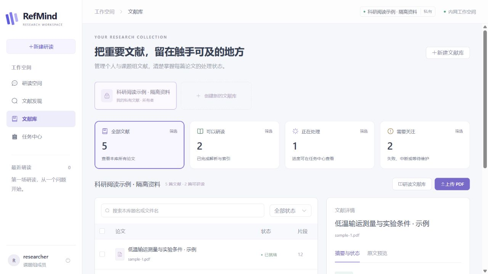

# RefMind · 科研阅读工作台

RefMind 把论文检索、全文研读、证据问答和文献管理放在一个工作空间中。提问时可以同时查看原文与引用，区分本地全文、外部摘要和会话全文，追踪答案使用了哪些证据。

目前主界面使用 **Vue 3 + TypeScript**，服务端使用 **FastAPI**。旧 Streamlit 界面保留作兼容回退。项目处于开发验证阶段，完整人工金标准及独立科研质量验收尚未完成。

## 工作空间

| 页面 | 主要用途 |
|---|---|
| 研读空间 | 问答与原文并排查看；点击引用定位论文和页面；查看实际证据及处理过程 |
| 文献发现 | 主动搜索论文、筛选题录、选择摘要问答或获取公开全文 |
| 文献库 | 管理私有与课题组共享资料；按可研读、处理中、需要关注筛选；查看索引维护状态 |
| 任务中心 | 查看下载、解析、问答、入库和维护申请；取消、重试及刷新后恢复 |
| 账号管理 | 管理员创建账号；文献库所有者单独授予共享库阅读或编辑权限 |



*界面示例使用隔离的合成资料，不代表真实论文数量或科研测评成绩。*

## 快速开始

准备 Python 3.11+、Git，以及符合 `frontend/package-lock.json` 中 Vite 要求的 Node.js（20.19+ 或22.12+）。以下命令适用于 Windows PowerShell，在项目根目录执行。

```powershell
git clone https://github.com/LiuYj9/RefMind.git
cd RefMind
python -m venv .venv
.\.venv\Scripts\python.exe -m pip install -r requirements-api.txt
Copy-Item .env.example .env
```

在本机 `.env` 填入所选供应商的密钥和模型配置，再构建界面、创建首个管理员账号：

```powershell
npm --prefix frontend ci
npm --prefix frontend run build
.\.venv\Scripts\python.exe -m refmind.web.manage create-user admin --admin
.\scripts\start_research.ps1
```

打开 **http://127.0.0.1:8000**。账号密码通过命令行交互输入，没有默认密码。API 文档在 `/docs`，健康检查在 `/api/health`。

首次使用可创建私有文献库并上传 PDF；解析与嵌入完成后，在文献详情发起研读。任务状态可在任务中心查看。

若需要开发前端，可另开终端运行 `npm --prefix frontend run dev`；Vite通过代理访问本机8000端口的API。只启动一个API进程，不使用多个worker共享写入同一数据库。详细启动和内网配置见 [运行指南](docs/research-workspace.md)。

## 科研证据流程


- **结构与来源**：优先MinerU解析，失败时可回退PyMuPDF；保留章节、物理页码、表格、公式、图像和位置。原始证据与检索表示分别保留。
- **检索范围**：检索使用选定且就绪的授权文献；生成前再次检查权限、就绪状态和已登记的索引版本/文件指纹。历史记录缺少可信版本时，需要核对来源后显式重建。
- **回答边界**：只有摘要时只回答摘要支持的内容；证据不足、范围受限、系统错误分别记录。图片派生描述不能代替原图成为精确数值的唯一依据。
- **可追溯性**：保存召回、重排、装包、实际生成上下文和引用信息。界面中的处理过程是诊断记录，不是答案可信度百分比。
- **可选增强**：多角度检索与抽取式证据压缩通过独立开关启用，默认关闭。压缩保留原文精确片段及省略边界，表格/公式等结构内容保持完整；异常时保留完整证据。机制测试不等于科研正确性验证。

参阅 [架构说明](docs/architecture.md)、[解析约定](docs/parsing-policy.md)、[切分约定](docs/chunking-policy.md) 与 [抽取式证据视图](docs/extractive-evidence-views.md)。

## 外部论文发现与全文研读

默认研读使用本地论文库，外部检索由用户主动提交。适配器支持Semantic Scholar、OpenAlex和Crossref，显示分源状态和部分成功结果。

1. 搜索关键词、完整题名或DOI，按年份、类型、来源和公开全文候选筛选；没有摘要的题录也保留。
2. 选择论文后，可以使用摘要回答，或明确点击获取公开全文。勾选论文不会自动下载。
3. 下载、文件身份核验、解析、索引分别显示状态。身份冲突阻止进入回答；部分解析需要用户确认可用范围。
4. 全文首先进入发起用户的私有会话，默认保留7天。只有显式选择目标文献库并具有编辑权限时才入库。
5. 相同文件重复入库复用已有文档，不同版本分别保留。资料到期后，历史回答保留最小引用快照，原文不可用时明确提示。

日期排序等仅作用于已取回候选的操作，会标明“当前结果”。外部服务失败不会静默换成另一组论文回答。供应商可用性和限流与算法质量分别记录。

## 配置与费用

`.env.example` 是完整配置模板，密钥只放在本机 `.env`。

| 配置 | 用途 |
|---|---|
| `CHAT_PROVIDER` / `EMBEDDING_PROVIDER` / `VISION_PROVIDER` | 分别选择 `openai` 或 `dashscope` |
| `OPENAI_API_KEY` / `DASHSCOPE_API_KEY` | 所选供应商的本机凭证 |
| `USE_FALLBACK_PARSER` | 强制使用PyMuPDF；未安装或无法运行MinerU时也有回退路径 |
| `CHUNK_SIZE` / `CHUNK_OVERLAP` | 普通文本切分目标和重叠；表格、公式遵循结构规则 |
| `ACADEMIC_SEARCH_ENABLED` | 是否允许用户主动发起外检，不代表自动联网 |
| `RESEARCH_MULTI_QUERY_ENABLED` | 科研路径的多角度检索，默认 `false` |
| `RESEARCH_EXTRACTIVE_COMPRESSION_ENABLED` | 抽取式证据压缩，默认 `false` |
| `DATABASE_PATH` / `UPLOAD_DIR` / `PARSED_DIR` / `CHROMA_PERSIST_DIR` | 数据库、原文、解析产物和索引位置 |

上传解析、嵌入、生成及审核可能产生供应商费用。OpenAI沿用应用费用账本，默认每日2美元、累计10美元；失败但实际用量未知的预占不自动释放。账本是应用估算，不能替代供应商账单。DashScope结果与OpenAI分开记录。不同嵌入供应商使用独立索引，不自动迁移或混用。

## 账号、维护与恢复

私有库仅所有者可访问；共享库区分所有者、编辑与只读成员。管理员身份不自动取得他人私有资料。API、Streamlit及离线维护使用写入锁，不能同时写入相同运行数据。

旧库归属需管理员显式登记。历史索引重建可在文献详情申请，申请只保存任务，不会在线自动重建。管理员停止写入服务、完成备份并独立核对原文指纹后执行；成功保留原文献ID与历史引用，失败时暂停该文献新问答并允许显式重试。

旧界面的本机回退命令为：

```powershell
.\.venv\Scripts\python.exe -m streamlit run app.py --server.address 127.0.0.1
```

已有团队账号的数据库默认禁止旧界面直接启动，回退操作与 `REFMIND_LEGACY_ADMIN_MODE` 的限制见 [运行指南](docs/research-workspace.md)。当前Dockerfile仍面向旧Streamlit入口，不等同于新版工作台部署。

备份、验证恢复、旧库认领及逐篇维护命令统一见 [运行指南](docs/research-workspace.md)。普通恢复先提取到独立目录；不会覆盖已有数据或费用账本。

## 开发验证与科研验收

```powershell
# 离线工程回归：使用隔离环境与测试替身，不是付费科研测评
.\.venv\Scripts\python.exe -B -m unittest discover -s tests -v
npm --prefix frontend test
npm --prefix frontend run build
```

科研测评分为四条独立轨道，分别报告，不合成一个总分：

| 轨道 | 目标 | 当前草案库存 | 正式人工批准 |
|---|---:|---:|---:|
| 科研问答 | 600题 | 284题 | 0 |
| 外部论文检索 | 120项 | 72项 | 0 |
| 四轮对话 | 30组 | 4组 | 0 |
| 结构解析 | 120页 | 2页局部标注 | 0 |

以上为2026-11-06的建设库存，不是验收通过数量。按领域配额和历史暴露情况扣除后，主问答候选上限为214题；仍需满足任务、语言、家族多样性与人工复核要求。旧100题文件及70/30归属保留，已暴露的旧保留题只能历史回归，不能充当新的独立盲验。

分阶段验证覆盖数据规范、冻结基线、解析/切分、召回/重排、上下文、生成/拒答/引用、外检、全文、多模态/多轮及独立试运行。模型评分仅辅助筛查，正式科研正确性以原文和真实人工审定为准。500篇论文与3–5人并发容量也需实测，不能用编译或单元测试通过替代。

详见 [测评说明](evaluation/README.md) 和 [阶段进度](docs/staged-acceptance-progress.md)。运行报告、冻结快照和人工复核工作包保存在本地；干净克隆不包含这些运行产物，也不包含原始论文、向量库或费用账本。

## 目录

```text
frontend/                  Vue工作台、PDF阅读器与处理过程展示
refmind/web/               FastAPI、账号权限、任务与离线管理
refmind/services/          入库、论文发现、全文与历史索引重建
refmind/rag/               检索、证据组织、生成与审核
refmind/parsing/           PDF结构解析、坐标和图片资产
refmind/storage/           SQLite、版本身份与运行锁
refmind/llm/               供应商适配、调用与费用记录
evaluation/                数据规范、指标、执行与人工审定工具
tests/                     离线工程测试
scripts/                   启动、诊断和测评辅助脚本
docs/                      架构、运行与验收说明
app.py                     旧Streamlit兼容入口
```

插件和可选MCP扩展见 [插件说明](docs/plugins-and-mcp.md)，相关依赖按需安装 `requirements-mcp.txt`。
